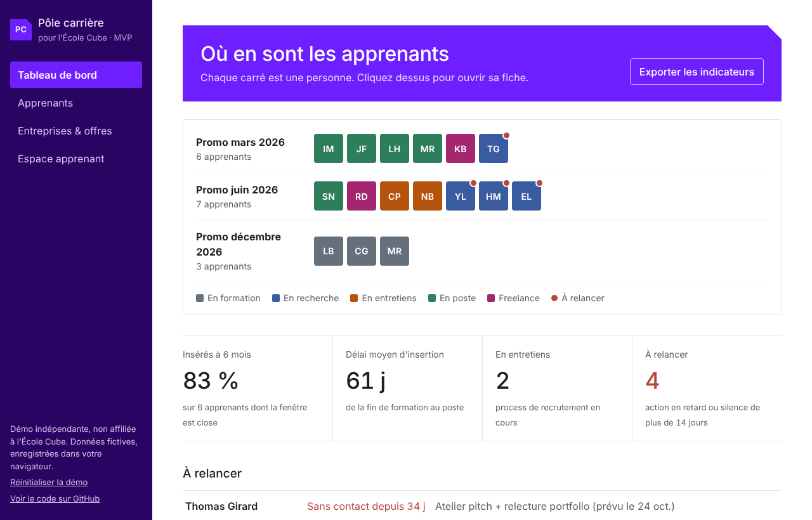

# Pôle carrière · École Cube (MVP)

[](https://github.com/gameirosandra-png/pole-carriere-cube/actions/workflows/ci.yml)

**Démo en ligne : [pole-carriere-cube.vercel.app](https://pole-carriere-cube.vercel.app)**

Outil pour accompagner les apprenants jusqu'à l'emploi et piloter le taux d'insertion, construit comme preuve de concept pour le pôle carrière de l'École Cube. Ce README est aussi une **étude de cas** : le problème, mes choix et ce que j'en ai appris.

**Pour voir l'essentiel en 2 minutes** : bouton « ▶ Démo auto » sur le site (le son est meilleur sur Edge).



## L'étude de cas en bref

| | |
| --- | --- |
| **Le besoin** | Accompagner les apprenants d'une école no-code jusqu'à l'emploi, et piloter le taux d'insertion |
| **Pour qui** | L'équipe du pôle carrière, les apprenants, la direction |
| **Ce que j'ai livré** | Une app en ligne, testée, documentée, avec un mode équipe sur base partagée |
| **En combien de temps** | Une journée, en 14 versions successives (voir l'[historique des commits](https://github.com/gameirosandra-png/pole-carriere-cube/commits/main)) |
| **Comment** | Je spécifie, je construis avec Claude, je vérifie par des tests, je déploie, puis j'itère sur les retours |

## Le problème

Après la formation, le suivi des apprenants est souvent dispersé entre tableurs, messages et mémoire. On perd de vue ceux qui décrochent, et le taux d'insertion, demandé pour le reporting RNCP et Qualiopi, est long à calculer.

Mais suivre ne suffit pas. Le vrai travail d'un pôle carrière, c'est d'**accompagner** : faire un CV qui tient la route, un portfolio qui convainc, annoncer un salaire juste, réussir un entretien. Puis **placer** : présenter les bons profils aux bonnes entreprises.

## Pourquoi moi sur ce sujet

Je suis apprenante Product Builder No-Code à l'École Cube, donc je connais ce parcours de l'intérieur. Avant, j'ai passé 10 ans à accompagner des personnes : infirmière et tutrice d'étudiants, puis responsable des opérations, avec 30+ managers formés et 300+ créateurs suivis. Ce projet réunit les deux : le terrain de l'accompagnement et la construction d'outils.

## Comment le produit a évolué

1. **V1, suivre** : tableau de bord par promo, taux d'insertion à 6 mois, apprenants à relancer, entreprises et offres.
2. **Retour d'un mentor du secteur** : « Ce qu'ils veulent, c'est de l'accompagnement : les CV, les portfolios, le salaire, convaincre. » J'ai recentré le produit sur ce retour.
3. **V2, accompagner** : un parcours en 7 séances, avec un atelier outillé pour chaque étape clé.
4. **V3, placer** : fiche candidat à envoyer aux entreprises, shortlist en un clic, matching expliqué, progression mesurée.
5. **Et pour le montrer** : une démo de 2 minutes commentée à voix haute, qui se lance seule.

## Mes choix, et pourquoi

| Choix | Pourquoi | Ce que j'accepte en échange |
| --- | --- | --- |
| Démo locale par défaut, base partagée en option | N'importe qui teste en un clic, sans compte ; les deux modes ont exactement les mêmes écrans | Deux façons de stocker les données à maintenir |
| Règles métier en fonctions pures, testées | Taux d'insertion, matching, prétention salariale : chaque règle se relit et se vérifie sans ouvrir l'interface | Un peu plus de code au départ |
| Un document JSON par fiche dans Supabase | Aller vite sans changer le modèle de l'app ; sécurité par RLS et taille bornée | Pas de requêtes fines côté base : un schéma normalisé est prévu en V2 |
| Les e-mails passent par des fonctions serveur et Make | Aucun secret dans le navigateur ; le destinataire est fixé dans Make, jamais par le visiteur | Un outil de plus dans la chaîne |
| La fiche candidat voyage dans le lien | Aucune base publique de profils : rien n'est stocké en ligne, c'est plus simple pour le RGPD | Le lien est long, et figé au moment où il est créé |
| L'IA reportée en V2 | Le brief de rendez-vous fonctionne déjà avec des règles ; l'IA ajoute un coût et un risque qu'un MVP n'a pas besoin de porter | La fonction est écrite et testée, mais pas activée |
| Fourchettes de salaire sourcées et datées | Une prétention se défend avec des chiffres vérifiables | Des chiffres indicatifs, dont certains anciens, à remplacer par les données réelles de l'école |

## Ce que j'ai appris

- **Construire avec l'IA, c'est surtout spécifier et vérifier.** Claude écrit vite ; mon travail est de dire précisément quoi construire, de relire, et de prouver que ça marche : 74 tests unitaires, plus de 160 vérifications de bout en bout et une intégration continue.
- **Le retour d'un expert vaut plus qu'une fonctionnalité de plus.** La V1 était juste techniquement mais à côté du vrai besoin.
- **Un MVP, c'est aussi savoir s'arrêter.** Rôles, temps réel, import des données de l'école : listés en V2, pas improvisés.

## Ses limites aujourd'hui

- Pas encore de rôles distincts (équipe, apprenant) sur la base partagée.
- Synchronisation toutes les 20 secondes, pas en temps réel.
- Récap et relances envoyés à l'équipe en un clic, mais pas encore programmés ni adressés aux vrais destinataires.
- La qualité de la voix de la démo dépend du navigateur (meilleure sur Edge).

---

# Découvrir l'app

## La méthode d'accompagnement

Le cœur du pôle carrière, c'est l'accompagnement : faire progresser chaque apprenant jusqu'à l'emploi. L'outil suit un **parcours en 7 séances**, et chaque séance clé a son atelier outillé dans la fiche de l'apprenant.

| Séance | Atelier dans la fiche | Ce qu'il produit |
| --- | --- | --- |
| 1. Bilan et objectif | Suivi | Poste visé, parcours d'avant à valoriser, prochaine action |
| 2. CV | **CV** | Revue sur 6 critères (titre, accroche, projets, résultats chiffrés, compétences, lisibilité), score sur 100, plan d'action priorisé, accroche « avant / après » |
| 3. Portfolio | **Portfolio** | Chaque projet évalué sur 5 critères (problème, solution, outils, démo, résultat), projet phare, modèle de fiche projet |
| 4. LinkedIn | Suivi | Coché par l'apprenant dans son espace |
| 5. Pitch | **Convaincre** | Pitch de 2 minutes en 4 temps, construit à partir de la fiche ; les passages à compléter sont surlignés |
| 6. Simulation d'entretien | **Convaincre** | 5 questions types, grille de simulation notée, critère à travailler |
| 7. Négociation salariale | **Salaire** | Fourchette du marché (sources datées), prétention argumentée, plancher, script de négociation |

En collectif, l'écran **Ateliers** planifie les ateliers par thème et propose d'inviter les apprenants dont la séance n'est pas encore faite. L'accueil montre **la semaine du pôle** : rendez-vous individuels, ateliers, actions en retard.

Et pour aller jusqu'à l'emploi :

- **Fiche candidat** : une page propre à envoyer aux entreprises (pitch, projets, préparation), sans notes internes ni salaire. Partageable par lien ou en PDF. Le lien contient les données de la fiche après le `#` : rien n'est stocké en ligne.
- **Shortlist** : depuis une offre, 3 profils maximum et un e-mail prêt, avec le lien de la fiche de chacun.
- **Progression** : les scores CV et entretien sont relevés à chaque séance ; une courbe montre l'avant / après, et le tableau de bord affiche le gain moyen.
- **Mode entraînement** : questions d'entretien tirées au hasard ou pitch, chrono de 2 minutes, en plein écran.
- **Relances automatiques** : rappels d'atelier (48 h avant) et messages aux apprenants sans contact depuis 14 jours, écrits par l'app et envoyés via Make en un clic.
- **Questionnaire « Faisons connaissance »** : rempli par l'apprenant avant la séance 1 (parcours, poste et secteurs visés, contrat, mobilité, inquiétudes, motivation). Les réponses remplissent la fiche, le pitch et l'atelier salaire, affinent le matching (contrat souhaité) et font remonter les points d'attention dans la fiche et le brief de rendez-vous.
- **Boîte à questions** : l'apprenant pose une question au pôle depuis son espace ; elle apparaît dans « Questions des apprenants » au tableau de bord, l'équipe répond depuis la fiche, et la réponse s'affiche chez l'apprenant.
- **Simulateur freelance** : « je veux 3 000 € net par mois » → le TJM à facturer, les jours facturés, le nombre de missions, le taux horaire, la part des cotisations et des frais ; ou l'inverse, à partir d'un TJM. Le résultat est situé sur le marché junior du poste visé, avec des alertes sur la TVA et le plafond de la micro-entreprise. Taux et seuils 2026 sourcés et datés, taux modifiable. Ouvert d'office pour un apprenant qui vise le freelance, et utilisable seul comme module à intégrer : [`/#simulateur-freelance`](https://pole-carriere-cube.vercel.app/#simulateur-freelance).
- **Boîte à outils de l'apprenant** : dans son espace, il retrouve son CV à corriger, son pitch, sa prétention et sa progression.

## Ce que fait le MVP

| Écran | Pour qui | Ce qu'on y fait |
| --- | --- | --- |
| Tableau de bord | Équipe | La semaine du pôle (rendez-vous, ateliers, retards), les relances automatiques prêtes à partir, les questions des apprenants en attente, puis chaque promo d'un coup d'œil, le taux d'insertion à 6 mois, le délai moyen, l'effet de l'accompagnement (gain moyen de score CV), l'entonnoir d'insertion avec son point de décrochage, les apprenants à relancer, et l'avancement des dossiers étape par étape. Exporter les indicateurs en CSV. |
| Apprenants | Équipe | Rechercher, filtrer (dont « prêts à proposer »), voir l'avancement de chaque dossier, ajouter un apprenant, exporter la liste en CSV (ouvrable dans Excel). |
| Fiche apprenant | Équipe | 6 onglets : Suivi (ce que l'apprenant a dit dans le questionnaire, ses questions, la courbe de progression), CV, Portfolio, Salaire, Convaincre (avec le mode entraînement), Fiche candidat. Changer le statut, valider les séances, planifier la prochaine action, noter les échanges, voir les offres proposées, supprimer la fiche. |
| Entreprises & offres | Équipe | Suivre les partenaires et leurs offres. **Suggérer des candidats** : les 3 meilleurs profils par offre, avec un score expliqué. Proposer, retirer, supprimer (avec annulation). **Envoyer la shortlist** à l'entreprise par e-mail. |
| Ateliers | Équipe | Planifier les ateliers collectifs, inscrire, inviter les apprenants qui en ont besoin. |
| Rapport | Direction | Rapport d'insertion d'une page par promo, prêt à imprimer ou à enregistrer en PDF. |
| Espace apprenant | Apprenant | Son tableau de bord (parcours, prochaine étape, offres), son questionnaire « Faisons connaissance », ses séances, une boîte à questions, sa boîte à outils (CV, pitch, prétention, progression, entraînement à l'oral), et un formulaire pour dire où il en est. Sa fiche se met à jour sans relance manuelle. |

Au premier passage, une **visite guidée** de 8 étapes présente l'app. La **démo auto** (2 minutes) déroule seule l'histoire d'un apprenant, de la semaine du pôle jusqu'à l'entreprise, entre un écran d'ouverture et un écran de fin avec les contacts, **commentée à voix haute** et présentée en sous-titres pour pouvoir être filmée telle quelle : voix neuronale du navigateur par défaut, ou voix générée par IA si les fichiers audio sont déposés (voir [docs/voix-demo.md](docs/voix-demo.md)). La démo avance au rythme de la voix ; on peut la couper, la mettre en pause (Espace) ou changer sa vitesse de 0,75× à 1,5× (bouton ou touches + et -).

> Toutes les données sont fictives et calculées à partir de la date du jour, pour que la démo reste cohérente quel que soit le jour de visite. Elles sont enregistrées dans le navigateur (localStorage) : aucune donnée personnelle ne quitte l'ordinateur.

## Mode équipe (base partagée)

Par défaut, l'app tourne en **démo locale** : données fictives dans le navigateur. Le bouton « Passer en mode équipe » permet de se connecter **par lien magique** (sans mot de passe) : les données vivent alors dans une base **Supabase** partagée, et chaque membre voit les mises à jour des autres (actualisation toutes les 20 secondes et au retour sur l'onglet).

- Schéma : tables `apprenants` et `entreprises`, un document JSON par ligne, au format de l'app (aucun écran ne change entre les deux modes). Horodatage et auteur de chaque modification par trigger.
- Sécurité : RLS activée, lecture et écriture réservées aux utilisateurs connectés ; taille des documents bornée.
- Synchronisation : seules les fiches ajoutées, modifiées ou supprimées sont envoyées ([`src/synchro.ts`](src/synchro.ts), testé).
- Client Supabase minimal, sans dépendance ([`src/supabase.ts`](src/supabase.ts)) : lien magique, rafraîchissement de session, lecture et écriture via l'API REST.

En production : rôles distincts (équipe, apprenant), politiques RLS par rôle, schéma normalisé (offres et candidatures en tables), temps réel.

## Automatisation et IA

| Fonction | Comment ça marche |
| --- | --- |
| **Relances (Make)** | Le bouton « Envoyer les relances » appelle [`api/relances.ts`](api/relances.ts), qui met en forme les messages préparés par l'app et les transmet au même scénario Make. En démo, tout arrive dans la boîte du pôle. |
| **Récap par e-mail (Make)** | Le bouton « Envoyer le récap par e-mail » appelle la fonction serveur [`api/recap.ts`](api/recap.ts), qui construit l'e-mail (apprenants à relancer, dossiers prêts, taux d'insertion) et le transmet à un scénario Make : *Webhook → Gmail → Réponse*. Le destinataire est fixé dans Make (l'équipe du pôle), jamais par le visiteur. |
| **Brief de rendez-vous** | Dans la fiche, « Préparer le rendez-vous » propose une synthèse en 3 rubriques (situation, points à travailler, questions à poser), calculée à partir du suivi ([`src/brief.ts`](src/brief.ts), testé). |

Les fonctions serveur limitent le rythme et le volume d'appels, et n'acceptent que des champs structurés et tronqués : elles ne peuvent servir ni de relais d'e-mails ni de chatbot générique.

Variable d'environnement (Vercel) : `MAKE_RECAP_WEBHOOK` (URL du webhook Make). Sans elle, l'app fonctionne et l'indique clairement.

## Règles métier

| Indicateur | Règle |
| --- | --- |
| Inséré | Statut « En poste » ou « Freelance » |
| Taux à 6 mois | Insérés dans les 6 mois après la fin de formation / apprenants dont ces 6 mois sont écoulés |
| Délai moyen | Jours entre la fin de formation et la date d'insertion |
| À relancer | Prochaine action dépassée, ou aucun contact depuis plus de 14 jours (hors apprenants en formation ou insérés) |
| Prêt à proposer | Les 7 séances du parcours bouclées |
| Simulateur freelance | Micro-entreprise, activité libérale : cotisations 25,6 % + formation 0,2 % (+ 2,2 % si versement libératoire) ; jours facturables = (52 − congés) × jours par semaine − 8 fériés, × part du temps facturée ; TJM arrondi à la dizaine supérieure ; plafond 83 600 €, TVA au-delà de 37 500 € |
| Prétention salariale | Départ à 25 % de la fourchette junior, puis + 20 points en Île-de-France, + 15 si 5 ans d'expérience avant la reconversion, + 10 si parcours bouclé, + 10 si 2 projets solides (plafond 85 %) ; plancher = 92 % de l'annonce |
| Qui coche quoi | L'apprenant coche portfolio et LinkedIn ; l'équipe valide les autres séances |
| KPI de préparation | Part des apprenants en accompagnement (non insérés) ayant fait chaque étape, et nombre de dossiers prêts |
| Score de matching (sur 100) | Parcours (40, proportionnel aux séances faites) + poste visé retrouvé dans l'intitulé de l'offre (35) + disponibilité (25 en recherche, 15 en entretiens ailleurs, 25 en formation pour une alternance, 5 sinon ; plafonnée à 5 si le contrat de l'offre n'est pas celui souhaité dans le questionnaire) |
| Entonnoir d'insertion | Sortis de formation → parcours bouclé → en entretiens ou au-delà → en poste ou freelance ; niveaux cumulatifs, le plus gros écart signale le goulot |
| Dernier contact | Mis à jour par une note, un changement de statut, une action faite ou une réponse de l'apprenant |

Ces règles sont des fonctions pures dans [`src/regles.ts`](src/regles.ts), [`src/dossier.ts`](src/dossier.ts), [`src/matching.ts`](src/matching.ts) et [`src/rapport.ts`](src/rapport.ts), couvertes par des tests.

## Qualité

- **Tests** : 74 tests unitaires sur les règles métier, parcours et ateliers d'accompagnement, matching, entonnoir, calculs de dates (fin de mois, changement d'heure, fuseaux) et export CSV, avec Vitest.
- **Bout en bout** : 188 vérifications Playwright dans [`e2e/`](e2e) (parcours complets dans un vrai navigateur, sur ordinateur et mobile), lancées avant chaque version avec `npm run e2e` ; pas encore dans la CI.
- **Intégration continue** : à chaque modification, GitHub vérifie les types TypeScript, lance les tests et le build ([workflow](.github/workflows/ci.yml)).
- **Accessibilité** : couleurs de statut au contraste WCAG AA (4,5:1), statut toujours écrit en plus de la couleur, panneaux utilisables au clavier (focus piégé, Échap, retour du focus).
- **Responsive** : utilisable sur mobile.

## Stack

React 19 + TypeScript, Vite, CSS sans framework, Vitest, Playwright. Supabase (Postgres, Auth), fonctions serveur Vercel, Make ; API Claude prête pour la V2. Déployé sur Vercel à chaque push sur `main`. Construit avec Claude.

## Lancer en local

```bash
npm install
npm run dev      # serveur de développement
npm run check    # types + tests + build, comme la CI
npm run build && npm run preview   # puis, dans un autre terminal :
npm run e2e      # vérifications de bout en bout (Playwright à installer : npm i -D playwright && npx playwright install chromium)
```

## Structure

```
src/
  types.ts            modèle de données (Apprenant, Entreprise, Offre)
  regles.ts           règles métier et indicateurs (testés)
  dossier.ts          checklist du dossier et KPI de préparation (testés)
  matching.ts         suggestion de candidats pour une offre (testé)
  accompagnement/     ateliers CV, portfolio, salaire (référentiel sourcé), pitch, ateliers collectifs,
                      progression, fiche candidat, shortlist, relances, entraînement, questionnaire,
                      simulateur freelance (testés)
  rapport.ts          entonnoir d'insertion et statistiques par promo (testés)
  narration.ts        voix de la démo : fichiers IA, sinon meilleure voix française du navigateur
  brief.ts            préparation de rendez-vous : données pour l'IA, brief de secours (testés)
  api.ts              appels aux fonctions serveur
  supabase.ts         client minimal : lien magique, session, lecture/écriture
  synchro.ts          calcul des changements à envoyer à la base (testé)
  dates.ts            calculs de dates sans décalage de fuseau (testés)
  csv.ts              export CSV compatible Excel (testé)
  store.ts            état de l'app et persistance locale
  data/seed.ts        données de démo, relatives à la date du jour
  components/         un composant par écran, plus le panneau accessible
e2e/                  vérifications de bout en bout (Playwright), lancées par npm run e2e
api/
  recap.ts            envoi du récap via Make
  relances.ts         envoi des relances automatiques via Make
  brief.ts            brief de rendez-vous rédigé par Claude (V2, prêt mais non activé)
```

## Prochaines étapes (V2)

1. Rôles et droits par profil (équipe, apprenant) sur la base partagée, et schéma normalisé.
2. Lien personnel et sécurisé pour l'espace apprenant, envoyé automatiquement chaque mois.
3. Récap et relances envoyés automatiquement par Make (chaque lundi, chaque matin), à partir de la base partagée, et aux vrais destinataires.
4. Import des apprenants depuis l'outil de gestion de l'école.
5. **Parcours freelance** : quand l'apprenant vise le freelance, les séances 6 et 7 deviennent « Se lancer » (comparatif des statuts, checklist de création, modèles de devis et factures) et « Fixer son TJM et décrocher sa première mission » (plateformes, pitch client).
6. **Brief de rendez-vous rédigé par l'IA** : la fonction serveur est prête ([`api/brief.ts`](api/brief.ts) : prompt borné, garde-fous de volume, modèle Claude Haiku). Activation = ajouter `ANTHROPIC_API_KEY` sur Vercel et brancher `demanderBrief` dans la fiche.

---

Conçu par Sandra Gameiro, Product & Operations Builder, apprenante Product Builder No-Code à l'École Cube · [LinkedIn](https://www.linkedin.com/in/sandra-gameiro/) · ladoucenaissance@gmail.com
